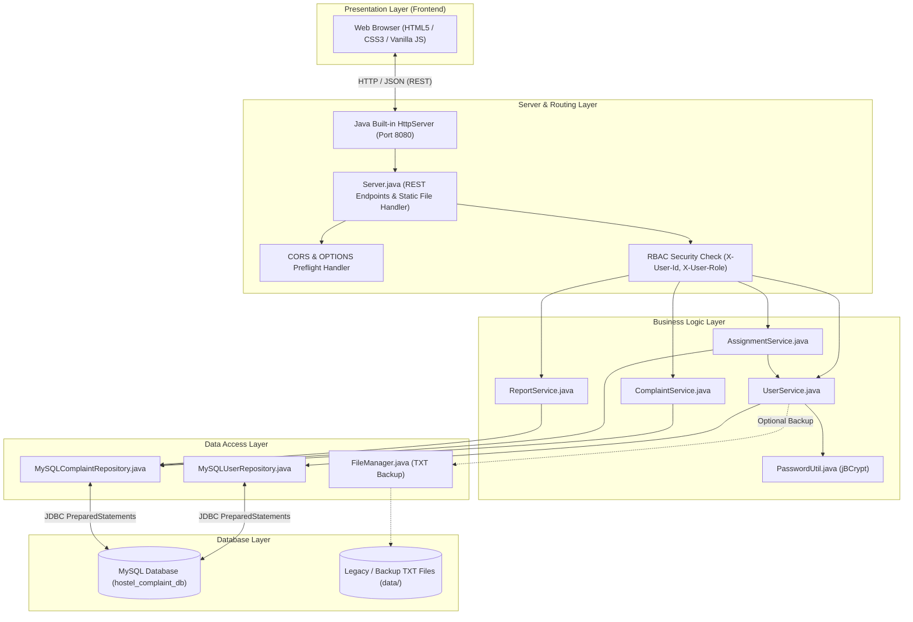
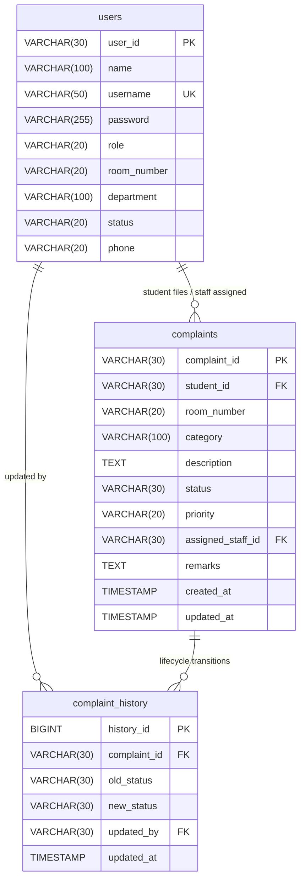

# Hostel Complaint & Maintenance Management System

An enterprise-grade, clean-architecture web application designed to automate, track, and streamline hostel maintenance workflows. Built using **Core Java OOP**, a lightweight built-in **Java HTTP Server**, **MySQL with JDBC**, and a modern, responsive **Vanilla HTML/CSS/JavaScript** frontend.

---

## Table of Contents

- [Overview](#overview)
- [Key Features](#key-features)
- [Technology Stack](#technology-stack)
- [Project Architecture](#project-architecture)
- [Project Folder Structure](#project-folder-structure)
- [Database Design](#database-design)
- [Application Modules](#application-modules)
- [Prerequisites](#prerequisites)
- [Database Setup](#database-setup)
- [Installation & Setup](#installation--setup)
- [How to Run the Project](#how-to-run-the-project)
- [Testing](#testing)
- [Security & Data Management](#security--data-management)
- [Academic Attribution](#academic-attribution)

---

## Overview

In traditional hostel environments, maintenance complaints (electrical failures, plumbing leaks, carpentry issues, Wi-Fi outages) are logged manually using paper registers or informal messaging channels. This leads to common operational issues:
- Unrecorded or lost complaint requests.
- Lack of accountability and delayed resolution times.
- Zero visibility for students regarding the status of their requests.
- Inability for hostel administration to monitor technician workloads or identify recurring infrastructural failures.

The **Hostel Complaint & Maintenance Management System** provides a centralized, transparent platform where students can lodge and track complaints, administrators can allocate tasks to specialized technicians and manage staff accounts, and maintenance personnel can update resolution progress with inspection remarks in real time.

---

## Key Features

### 1. Student Portal
- **Self Registration & Authentication**: Secure student account creation with room assignment and BCrypt password encryption.
- **Complaint Lodging**: Submit complaints with category, room number, priority level (Low, Medium, High), and detailed description.
- **Real-Time Status Tracking**: Monitor complaint progress across standard lifecycle stages (`PENDING` → `ASSIGNED` → `IN_PROGRESS` → `RESOLVED`).
- **Complaint History**: View past complaints with assigned technician details and resolution remarks.

### 2. Maintenance Staff Portal
- **Dedicated Technician Dashboard**: Immediate summary of assigned tasks and workload metrics.
- **Work Queue**: Department-specific complaint view (Electrical, Plumbing, Cleaning, Carpentry, Network/IT, General Maintenance).
- **Status Updates & Inspection Remarks**: Transition tasks to `IN_PROGRESS` or `RESOLVED` while adding technical notes and parts replaced.

### 3. Administrator Portal
- **Operational Analytics Dashboard**: Visual breakdown of total complaints, pending vs. resolved tasks, category distribution, and priority distribution.
- **Complaint Assignment & Reallocation**: One-click assignment of pending complaints to active department technicians.
- **Complete Staff Management**:
  - Add new maintenance personnel with automatic ID generation (`ST%03d`) and BCrypt password hashing.
  - View staff workloads, contact details, and department tags.
  - Edit staff profiles (name, department, phone number).
  - Deactivate/Reactivate staff accounts safely without deleting historical work logs or foreign-key relationships.
- **Student Directory**: Inspect registered students and view their complete complaint history.
- **Background Multithreaded Reports**: Asynchronous background report generation demonstrating Java multithreading (`ReportService`).

---

## Technology Stack

| Layer | Technologies & Libraries |
| :--- | :--- |
| **Backend Language** | Java Core (JDK 17+) — OOP, Inheritance, Polymorphism, Abstraction, Enums, Streams, Threads |
| **HTTP Server Engine** | Built-in Java HTTP Server (`com.sun.net.httpserver.HttpServer`) — Lightweight, zero external server dependency |
| **Database & Persistence** | MySQL Server 8.0+ / 8.4+, JDBC (`java.sql.*`), PreparedStatements, Transactions |
| **Database Driver** | MySQL Connector/J 8.4.0 (`lib/mysql-connector-j-8.4.0.jar`) |
| **Security / Hashing** | jBCrypt 0.4 (`lib/jbcrypt-0.4.jar`) with salted BCrypt hashing (12 log rounds) |
| **Frontend** | Vanilla HTML5, Modern CSS3 (Variables, Flexbox, Grid, Responsive), Vanilla JavaScript (ES6+, Fetch API, Async/Await) |
| **Data Interchange** | Custom zero-dependency JSON parser & serializer in `Server.java` |
| **Legacy & Backup** | Delimited TXT file handling via `FileManager.java` and `DataMigrationManager.java` |

---

## Project Architecture

The application adopts a **Clean Multi-Tier Architecture** separating presentation, routing, business logic, data persistence, and database storage.



### Request Flow
1. **Client Request**: The browser dispatches a fetch request with JSON payload and custom authorization headers (`X-User-Id`, `X-User-Role`).
2. **HTTP Router (`Server.java`)**: Handles CORS preflight (`OPTIONS`), validates caller identity against the database, and routes requests to appropriate service methods.
3. **Service Layer**: Executes business rules, input validations, BCrypt hashing, and role verification.
4. **Repository Layer**: Executes parameterized SQL queries using `java.sql.PreparedStatement` within try-with-resources blocks.
5. **Database**: MySQL persists relational records across `users`, `complaints`, and `complaint_history` tables.
6. **Response**: Server serializes domain objects to JSON and returns standard HTTP status codes (`200 OK`, `201 Created`, `400 Bad Request`, `401 Unauthorized`, `403 Forbidden`, `404 Not Found`).

---

## Project Folder Structure

```
HostelComplaintSystem/
├── data/                                # Local delimited TXT storage files
│   ├── complaints.txt                   # Backup / export complaints store
│   └── users.txt                        # Backup / export users store
├── frontend/                            # Static web frontend assets
│   ├── index.html                       # Application login page
│   ├── register.html                    # Student self-registration page
│   ├── admin/                           # Administrator dashboard & portal pages
│   │   ├── assign.html                  # Quick complaint assignment view
│   │   ├── complaints.html              # All complaints management & filtering
│   │   ├── dashboard.html               # Main admin analytics & overview
│   │   ├── reports.html                 # Detailed reports & category charts
│   │   ├── staff.html                   # Staff management directory & CRUD modals
│   │   └── students.html                # Student directory & history
│   ├── staff/                           # Maintenance staff portal pages
│   │   ├── complaints.html              # Assigned complaints & status updates
│   │   ├── dashboard.html               # Staff task queue overview
│   │   └── profile.html                 # Staff profile & department details
│   ├── student/                         # Student portal pages
│   │   ├── complaints.html              # My complaints history & live timeline
│   │   ├── create-complaint.html        # New complaint submission form
│   │   ├── dashboard.html               # Student dashboard
│   │   └── profile.html                 # Student profile & room details
│   ├── css/                             # Modular styling
│   │   ├── dashboard.css                # Dashboard layouts, cards & charts
│   │   ├── forms.css                    # Form controls, inputs & buttons
│   │   ├── responsive.css               # Mobile & tablet media queries
│   │   └── style.css                    # Base styling, badges & typography
│   └── js/                              # Frontend scripts
│       ├── admin.js                     # Admin dashboard & staff management logic
│       ├── api.js                       # HTTP client wrapper with auth headers
│       ├── app.js                       # Global navigation & theme controller
│       ├── auth.js                      # Authentication & session management
│       ├── complaints.js                # Complaint rendering & badge helpers
│       ├── data.js                      # Cache & client-side helper store
│       ├── staff.js                     # Staff portal interactions
│       ├── student.js                   # Student lodging & tracking logic
│       └── ui.js                        # Modals, toast notifications & DOM utilities
├── lib/                                 # External Java dependencies (.jar)
│   ├── jbcrypt-0.4.jar                  # BCrypt password hashing library
│   └── mysql-connector-j-8.4.0.jar      # Official MySQL JDBC Driver
├── src/                                 # Java backend source code
│   ├── database/                        # Database connectivity & seeders
│   │   ├── DatabaseConnection.java      # JDBC connection manager & config loader
│   │   ├── DatabaseConnectionTest.java  # Connection smoke test utility
│   │   └── DataSeeder.java              # Demonstration dataset populator
│   ├── exception/                       # Custom business exceptions
│   │   ├── ComplaintNotFoundException.java
│   │   ├── InvalidCredentialsException.java
│   │   ├── InvalidInputException.java
│   │   └── UserNotFoundException.java
│   ├── model/                           # Domain OOP entities & enums
│   │   ├── Admin.java                   # Admin entity extending User
│   │   ├── Complaint.java               # Complaint entity
│   │   ├── ComplaintPriority.java       # Priority enum (LOW, MEDIUM, HIGH)
│   │   ├── ComplaintStatus.java         # Status enum (PENDING, ASSIGNED, IN_PROGRESS, RESOLVED)
│   │   ├── Staff.java                   # Staff entity extending User
│   │   ├── Student.java                 # Student entity extending User
│   │   └── User.java                    # Abstract User base class
│   ├── repository/                      # Data access abstractions & implementations
│   │   ├── ComplaintRepository.java     # Complaint repository interface
│   │   ├── FileManager.java             # Legacy TXT persistence implementation
│   │   ├── MySQLComplaintRepository.java# JDBC implementation for complaints & history
│   │   ├── MySQLUserRepository.java     # JDBC implementation for user accounts
│   │   └── UserRepository.java          # User repository interface
│   ├── server/                          # HTTP Server & API Gateway
│   │   └── Server.java                  # Built-in HttpServer, routing, JSON & security
│   ├── service/                         # Business logic services
│   │   ├── AssignmentService.java       # Staff task allocation & validation
│   │   ├── ComplaintService.java        # Complaint lifecycle & updates
│   │   ├── ReportService.java           # Metrics calculation & background threads
│   │   └── UserService.java             # User registration, login & staff management
│   ├── test/                            # Automated integration & verification tests
│   │   ├── DemoDataVerificationTest.java
│   │   ├── EndToEndVerificationTest.java
│   │   ├── HttpApiIntegrationTest.java
│   │   ├── MigrationIntegrationTest.java
│   │   ├── RepositoryIntegrationTest.java
│   │   ├── ServiceIntegrationTest.java
│   │   └── StaffManagementIntegrationTest.java
│   ├── util/                            # Shared utilities
│   │   ├── DataMigrationManager.java    # Safe TXT <-> MySQL import & export CLI
│   │   └── PasswordUtil.java            # BCrypt hashing & password verification
│   └── Main.java                        # Primary application entry point
├── .gitignore                           # Git ignore rules (credentials, build outputs)
├── db.properties.example                # Safe database configuration template
├── HostelComplaintSystem.iml            # IntelliJ IDEA module descriptor
└── schema.sql                           # MySQL database schema DDL & indexes
```

---

## Database Design

The relational database is structured in 3 normalized tables enforcing referential integrity and audit trails.



### Table Specifications

1. **`users`**:
   - `user_id` (PK): Unique identifier (e.g., `ADM001`, `S001`, `ST001`).
   - `username` (UNIQUE): Case-insensitive unique handle.
   - `password`: 60-character salted BCrypt hash string.
   - `role`: Role discriminator (`STUDENT`, `STAFF`, `ADMIN`).
   - `room_number`: Room assigned to student (e.g., `B-204`).
   - `department`: Maintenance specialization for staff (e.g., `Electrical`, `Plumbing`).
   - `status`: Account state (`ACTIVE`, `INACTIVE`).
   - `phone`: Contact telephone number.

2. **`complaints`**:
   - `complaint_id` (PK): Formatted identifier (`C001`, `C002`, ...).
   - `student_id` (FK): References `users(user_id)` with `ON DELETE RESTRICT`.
   - `assigned_staff_id` (FK): References `users(user_id)` with `ON DELETE SET NULL`.
   - `status`: Current lifecycle phase (`PENDING`, `ASSIGNED`, `IN_PROGRESS`, `RESOLVED`).
   - `priority`: Urgency level (`LOW`, `MEDIUM`, `HIGH`).
   - `remarks`: Technician inspection notes.

3. **`complaint_history`**:
   - `history_id` (PK): Auto-incrementing record ID.
   - `complaint_id` (FK): Cascading reference to `complaints(complaint_id)`.
   - `old_status` / `new_status`: Transition audit record.
   - `updated_by` (FK): User ID of the student, staff, or admin triggering the change.
   - `updated_at`: Timestamp of status change.

---

## Application Modules

### 1. Authentication & Security Module
- Centralized login for all roles via `POST /api/login`.
- Password verification using `BCrypt.checkpw()`.
- Deactivated accounts are automatically blocked during login (`401 Unauthorized`).
- RBAC verification protects endpoints: admin-only operations (staff creation, complaint assignment) return `403 Forbidden` if invoked by students or staff.

### 2. Complaint Management Module
- Sequential ID generator producing clean formatted identifiers (`C%03d`).
- Lifecycle management ensuring status changes are valid and accompanied by audit log records.
- Inactive staff members cannot be assigned complaints (`400 Bad Request`).

### 3. Staff Management Module
- Allows administrators to manage personnel directly through the UI.
- Generates sequential IDs (`ST004`, `ST005`, ...) based on existing records.
- Full Name, Department, and Contact Number can be updated while preserving existing assigned history.
- Soft-deactivation changes `status` to `INACTIVE` instead of deleting database rows, safeguarding historical complaints.

### 4. Reporting & Analytics Module
- Calculates real-time metrics directly from MySQL (total, status counts, category counts, priority breakdown).
- Features a multithreaded background generator (`ReportService.generateReportInBackground()`) that outputs reports asynchronously without blocking user requests.

---

## Prerequisites

Before setting up the project, ensure you have the following installed on your machine:

1. **Java Development Kit (JDK)**: Version **17 or higher** (JDK 17 LTS, JDK 21 LTS, or JDK 26).
   ```powershell
   java -version
   javac -version
   ```
2. **MySQL Server**: Version **8.0 or higher** (running locally on port `3306`).
3. **Integrated Development Environment (IDE)**: IntelliJ IDEA (Community or Ultimate edition recommended).
4. **Git**: Installed and available in PATH.

---

## Database Setup

### Step 1: Start MySQL Server
Ensure your local MySQL service is active (via Windows Services or MySQL Workbench).

### Step 2: Initialize Database & Tables
Open your terminal (PowerShell, CMD, or Git Bash) and execute `schema.sql`:

**PowerShell (Windows):**
```powershell
Get-Content schema.sql -Raw | & "C:\Program Files\MySQL\MySQL Server 8.0\bin\mysql.exe" -u root -p
```

**Git Bash / Linux:**
```bash
mysql -u root -p < schema.sql
```
*(Enter your MySQL root password when prompted)*

### Step 3: Configure `db.properties`
Copy the template file `db.properties.example` to create your private `db.properties` in the project root:

**PowerShell:**
```powershell
Copy-Item db.properties.example db.properties
```

**Git Bash:**
```bash
cp db.properties.example db.properties
```

Edit `db.properties` with your actual MySQL password:
```properties
DB_URL=jdbc:mysql://localhost:3306/hostel_complaint_db?useSSL=false&allowPublicKeyRetrieval=true&serverTimezone=UTC
DB_USERNAME=root
DB_PASSWORD=YourActualMySQLPasswordHere
```

> [!IMPORTANT]
> `db.properties` is strictly ignored by `.gitignore` and must never be committed to GitHub.

### Step 4 (Optional): Populate Seed Demonstration Data
To populate the database with realistic demo accounts (1 Admin, 3 Students, 3 Staff, 12 Complaints), run `DataSeeder`:

**PowerShell:**
```powershell
java -cp "out/production/HostelComplaintSystem;lib/*" database.DataSeeder
```

#### Pre-Configured Demonstration Accounts

| Role | User ID | Username | Password | Details |
| :--- | :--- | :--- | :--- | :--- |
| **Admin** | `ADM001` | `admin` | `Admin@123` | Hostel Chief Warden |
| **Student 1** | `S001` | `student01` | `Student@123` | Room B-204 (Rahul Sharma) |
| **Student 2** | `S002` | `student02` | `Student@123` | Room C-102 (Ananya Verma) |
| **Student 3** | `S003` | `student03` | `Student@123` | Room A-301 (Rohan Gupta) |
| **Staff 1** | `ST001` | `staff01` | `Staff@123` | Electrical Dept (Ramesh Kumar) |
| **Staff 2** | `ST002` | `staff02` | `Staff@123` | Plumbing Dept (Suresh Patel) |
| **Staff 3** | `ST003` | `staff03` | `Staff@123` | Cleaning Dept (Mahesh Singh) |

---

## Installation & Setup

### Setting up in IntelliJ IDEA

1. **Clone the Repository**:
   ```bash
   git clone https://github.com/your-username/HostelComplaintSystem.git
   cd HostelComplaintSystem
   ```
2. **Open in IntelliJ IDEA**:
   - Open IntelliJ IDEA → Click **Open** → Select the `HostelComplaintSystem` folder.
3. **Configure Project SDK**:
   - Navigate to **File → Project Structure → Project**.
   - Set **SDK** to **JDK 17** (or your installed JDK 17+ version).
   - Set **Language level** to **17 - Sealed types, always-strict floating-point, etc.**
4. **Verify Dependencies**:
   - Under **File → Project Structure → Modules → Dependencies**, confirm `lib/` is listed. Both `jbcrypt-0.4.jar` and `mysql-connector-j-8.4.0.jar` will be available automatically via `HostelComplaintSystem.iml`.
5. **Set up `db.properties`**:
   - Ensure you created `db.properties` with your MySQL credentials as described in [Database Setup](#database-setup).

---

## How to Run the Project

### Option A: Running from IntelliJ IDEA
1. In the Project Explorer, open `src/Main.java`.
2. Click the green **Run** button next to `public static void main(String[] args)` (or press `Shift + F10`).
3. The server starts with console output:
   ```
   =================================================
      HOSTEL COMPLAINT & MAINTENANCE SYSTEM         
   =================================================
   Hostel Complaint System Backend started at http://localhost:8080
   ```

### Option B: Running from Terminal (PowerShell / Windows CMD)

1. **Compile all Java source files**:
   ```powershell
   javac -cp "lib/*;src" -d "out/production/HostelComplaintSystem" src/model/*.java src/database/*.java src/util/*.java src/repository/*.java src/service/*.java src/server/*.java src/Main.java
   ```

2. **Execute the application**:
   ```powershell
   java -cp "out/production/HostelComplaintSystem;lib/*" Main
   ```

### Accessing the Application

- **Web Application Portal**: Open your browser and navigate to:
  ```
  http://localhost:8080
  ```
  *(or `http://localhost:8080/index.html`)*
- **Backend Health Check**:
  ```
  http://localhost:8080/api/health
  ```
  Expected Response:
  ```json
  {
    "status": "UP",
    "database": "CONNECTED",
    "message": "Hostel Complaint System Backend is running."
  }
  ```

---

## Testing

The project includes automated integration tests that run against the local MySQL instance to verify database queries, REST API responses, security rules, and business logic.

### Available Test Suites

| Test Suite Class | Focus Area | Verified Result |
| :--- | :--- | :---: |
| [`test.StaffManagementIntegrationTest`](file:///C:/Users/Prabal/IdeaProjects/HostelComplaintSystem/src/test/StaffManagementIntegrationTest.java) | Staff CRUD, BCrypt hashing, login, deactivation/reactivation, assignment blocking, RBAC | **12 / 12 Passed** |
| [`test.DemoDataVerificationTest`](file:///C:/Users/Prabal/IdeaProjects/HostelComplaintSystem/src/test/DemoDataVerificationTest.java) | All 7 seeded accounts, complaint filtering, lodge complaint, reports, static asset serving | **7 / 7 Passed** |
| [`test.HttpApiIntegrationTest`](file:///C:/Users/Prabal/IdeaProjects/HostelComplaintSystem/src/test/HttpApiIntegrationTest.java) | Health check, CORS preflight, registration, assignment, update status, and remarks | **Verified** |
| [`test.RepositoryIntegrationTest`](file:///C:/Users/Prabal/IdeaProjects/HostelComplaintSystem/src/test/RepositoryIntegrationTest.java) | Direct JDBC PreparedStatement operations for `MySQLUserRepository` & `MySQLComplaintRepository` | **Verified** |
| [`test.ServiceIntegrationTest`](file:///C:/Users/Prabal/IdeaProjects/HostelComplaintSystem/src/test/ServiceIntegrationTest.java) | Service-layer transactions, audit trail logging, and custom exception handling | **Verified** |
| [`test.MigrationIntegrationTest`](file:///C:/Users/Prabal/IdeaProjects/HostelComplaintSystem/src/test/MigrationIntegrationTest.java) | Safe TXT to MySQL import and MySQL to TXT export | **Verified** |

### Running the Tests via Terminal

**Compile test classes:**
```powershell
javac -cp "lib/*;src" -d "out/production/HostelComplaintSystem" src/model/*.java src/database/*.java src/util/*.java src/repository/*.java src/service/*.java src/server/*.java src/test/*.java
```

**Execute Staff Management Tests:**
```powershell
java -cp "out/production/HostelComplaintSystem;lib/*" test.StaffManagementIntegrationTest
```

**Execute Demo Data Verification Tests:**
```powershell
java -cp "out/production/HostelComplaintSystem;lib/*" test.DemoDataVerificationTest
```

---

## Security & Data Management

1. **Password Hashing**:
   - Plaintext passwords are never stored in MySQL or TXT backups.
   - All passwords are encrypted with **jBCrypt** using a secure salt round factor of 12 (`PasswordUtil.hashPassword()`).
   - Plaintext passwords are never returned in JSON API responses.

2. **Database Credential Protection**:
   - The production credentials file `db.properties` is explicitly ignored by version control via `.gitignore`.
   - A sanitized template `db.properties.example` is provided for new collaborators.

3. **SQL Injection Prevention**:
   - All database queries use parameterized `PreparedStatement`s with explicit type binding. No dynamic SQL concatenation is used.

4. **Role-Based Access Control (RBAC)**:
   - Server-side caller authentication evaluates `X-User-Id` and `X-User-Role` headers against MySQL before processing requests.
   - Unauthorized attempts by students or staff to invoke administrative endpoints return `HTTP 403 Forbidden`.

5. **Legacy TXT Data Import & Export**:
   - The application supports bidirectional synchronization between legacy TXT files and MySQL via [`DataMigrationManager.java`](file:///C:/Users/Prabal/IdeaProjects/HostelComplaintSystem/src/util/DataMigrationManager.java):
     ```powershell
     # Import legacy TXT data into MySQL
     java -cp "out/production/HostelComplaintSystem;lib/*" util.DataMigrationManager import

     # Export current MySQL database records to TXT files for backup
     java -cp "out/production/HostelComplaintSystem;lib/*" util.DataMigrationManager export
     ```

---

## Academic Attribution

This project was developed as an academic software engineering and database management system project at:

**Vishwakarma Institute of Technology, Pune**  
Department of Computer Engineering / Information Technology  

*Developed using Core Java OOP, JDBC, MySQL, and Modern Web Standards.*
